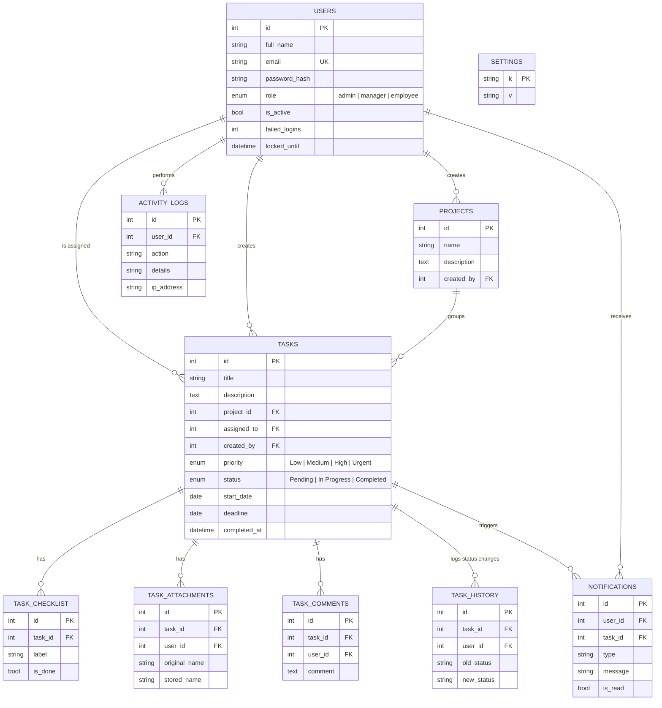

# Database design (ER diagram)

Open this file in VS Code with the "Markdown Preview Mermaid Support" extension, or paste the block into https://mermaid.live to see the diagram.

**Overdue is not a stored status.** A task is *Overdue* when `status <> 'Completed' AND deadline < today`, so it is always correct without a scheduled job.
